# Sample emails

What each email from PAL GOLF looks like, with sample names and dates. Images are in
[samples/emails/](samples/emails/).

All samples use made-up details: **Juan Dela Cruz**, captain **Maria Santos**, the
**PAL Golf Invitational 2026** (Saturday, December 5 2026, Sample Golf & Country Club, Tagaytay),
and the **PAL Golf Rules Briefing (Online)** for the online-meeting emails.

---

## About your account

### Confirm your email
Sent right after you create an account, if your organizer requires email confirmation.

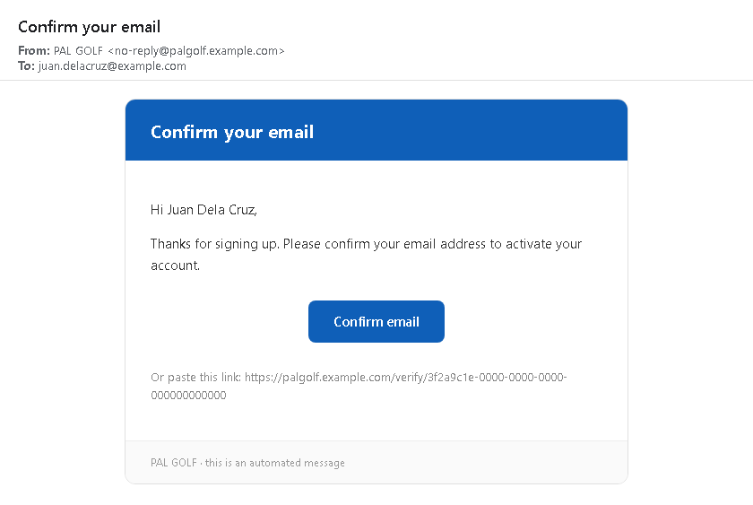

### Complete your registration
Sent by your team captain to finish setting up the account they created for you. The link works
once and expires after 7 days.

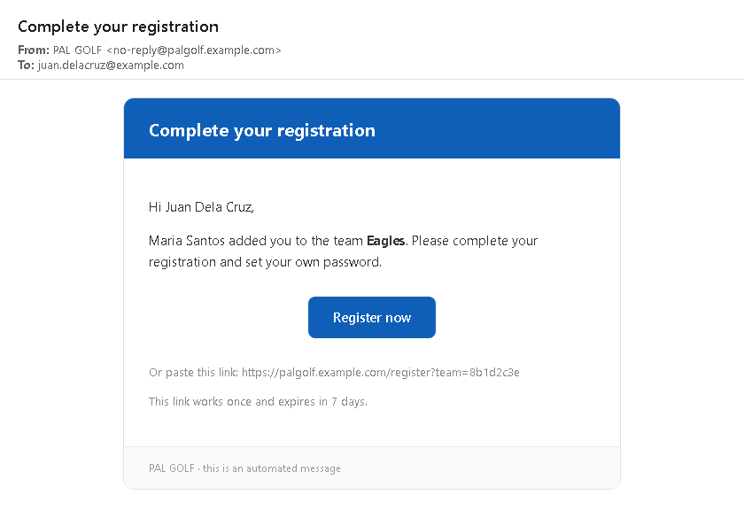

---

## Invitations

### You're invited
Sent when an organizer invites you to an event. It includes a calendar invite.

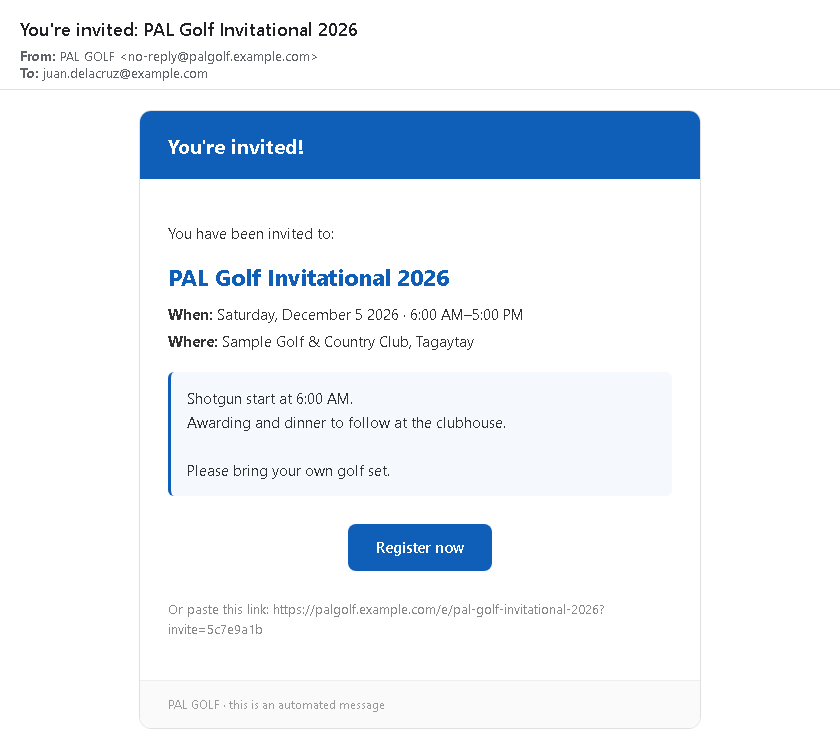

### Invitation from the organizer
A custom invitation written by the organizer, sent right away or on a set date and time. The
subject and message change each time; the event card below the message is always included.

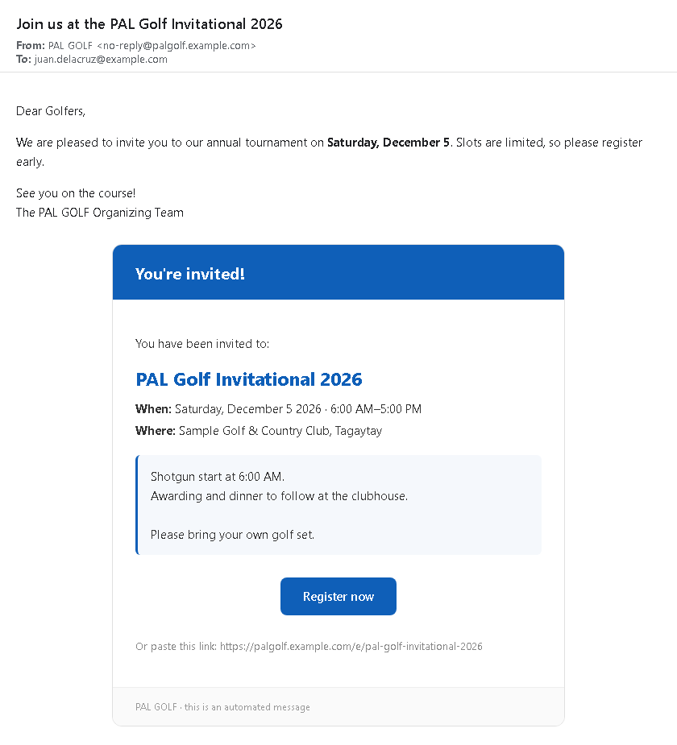

### Event updated
Sent when the event's date, time or venue changes. Your calendar entry updates automatically.

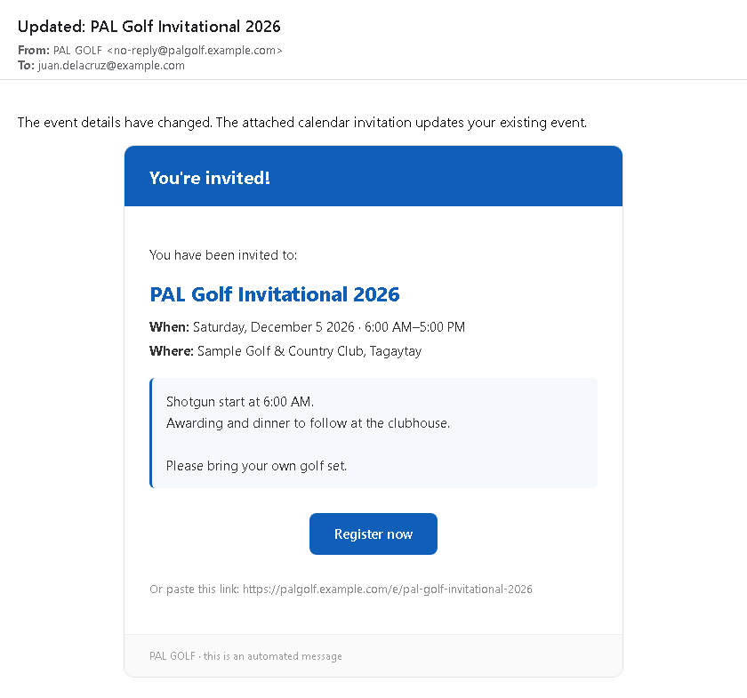

### Event cancelled
Sent when the event is cancelled. The entry is removed from your calendar.

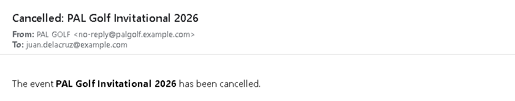

---

## Your registration and pass

### Registration confirmed (with pass)
Sent when an organizer approves your registration. Shows your QR pass and any meal stubs. If you
ask for your pass again, you receive this same email.

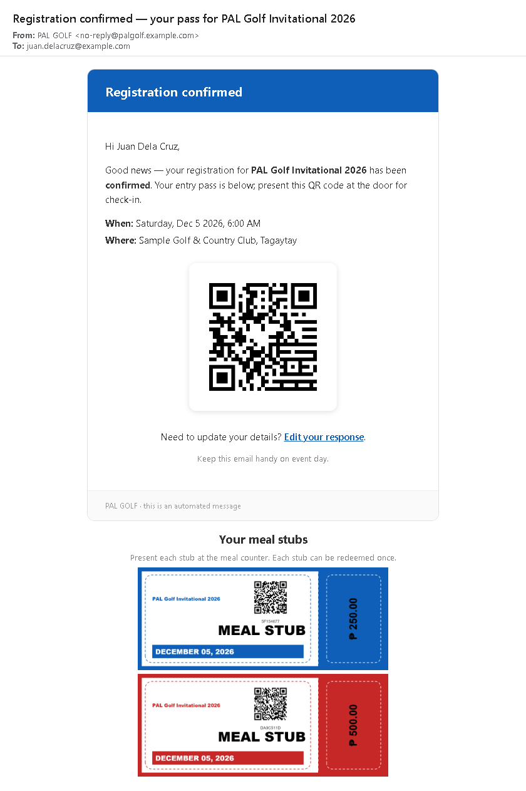

### Registration confirmed (online event)
Sent when your registration for an online-only event is approved. Contains the meeting link and a
calendar invite; there is no QR pass.

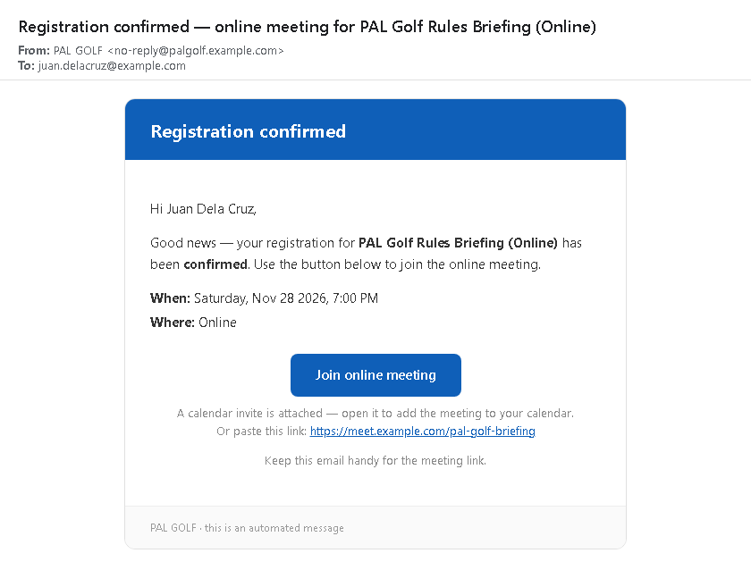

### Edit your registration
Sent when you registered without an account and asked for a link to change your answers.

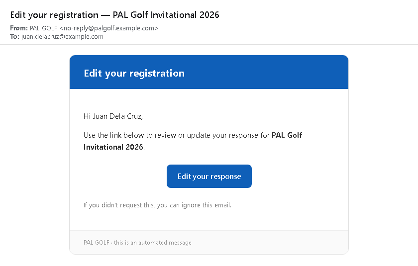

### Event kit claimed
Sent when your event kit is picked up, by you or by someone on your behalf.

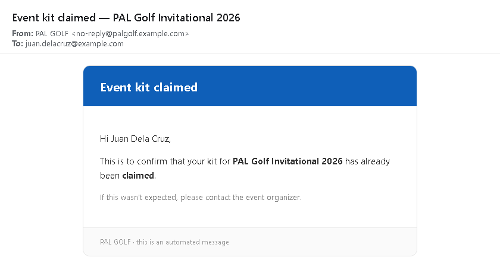

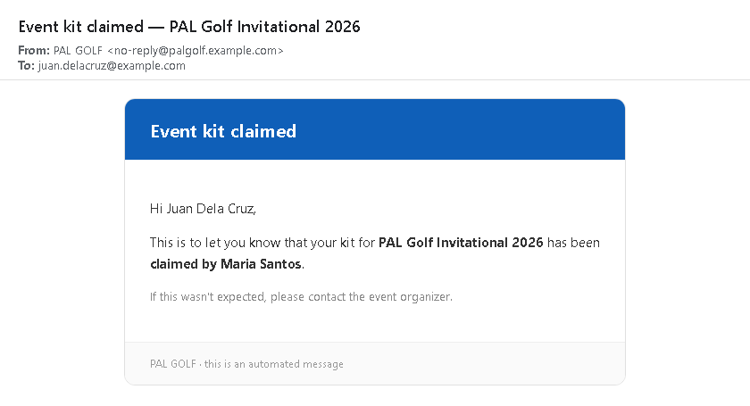

---

## Online meeting changes

### Meeting details updated
Sent when the online meeting link or time changes.

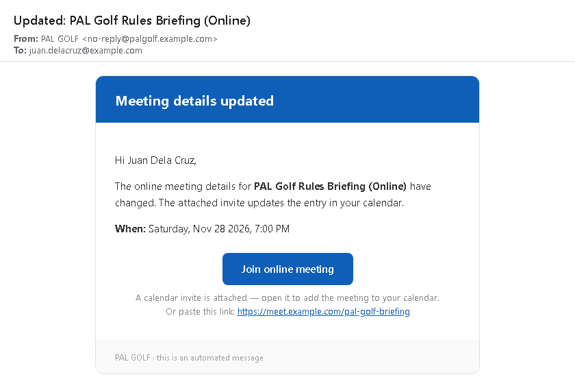

### Event cancelled (online)
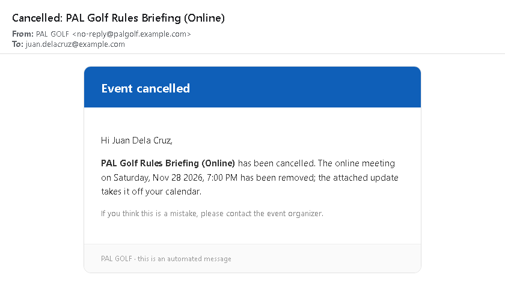

### Registration cancelled
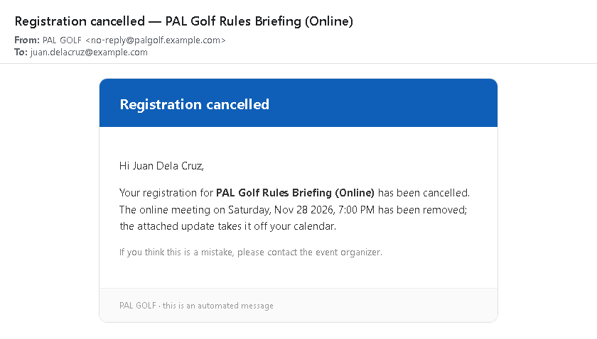

### Online meeting removed
Sent when the event becomes in person only. Your registration still stands.

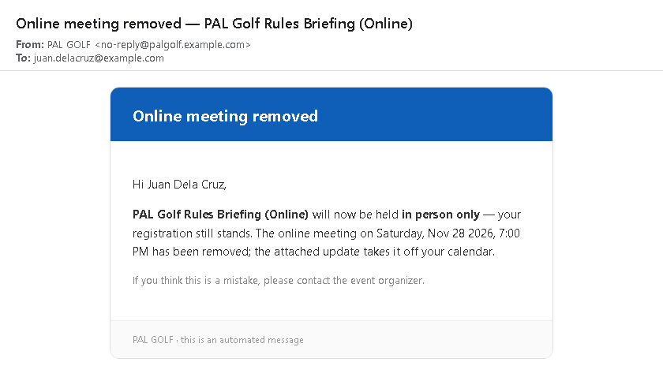

---

## Announcements and reminders

### Announcement from the organizer
The subject and message are written by the organizer. The event card and footer are always included.

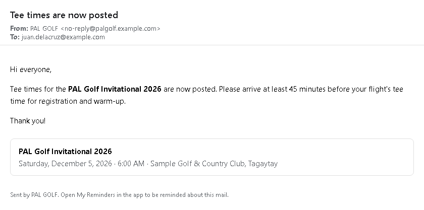

### Reminder
Sent at the time you chose when you asked to be reminded about an announcement.

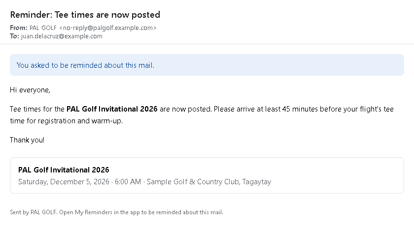
